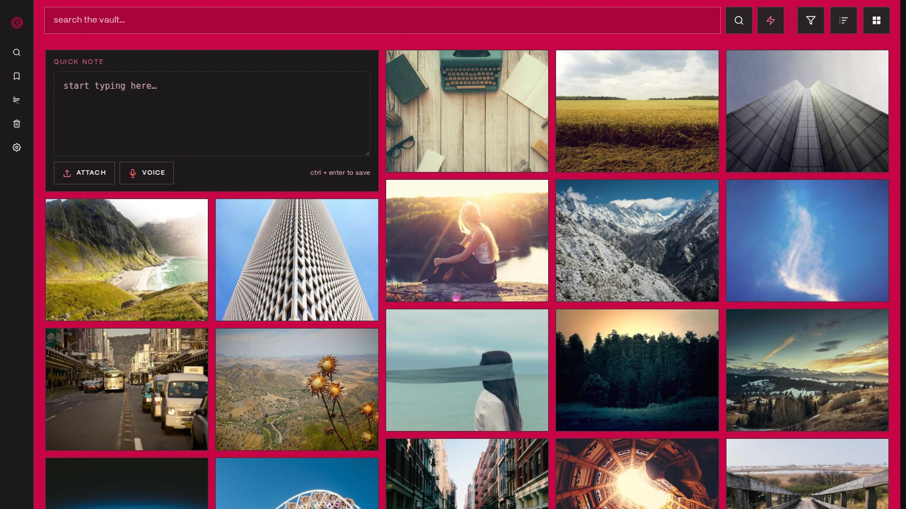

# Taste Engine

> A vault that remembers how a thing looked, not just what it was called.

Self-hosted visual bookmark vault. Save a post from your browser, then find it
again by look and feel: CLIP similarity search, the dominant palette, a hue
filter, and an AI explainer written against your own saved taste. One Rust
binary serves the website, the REST API and the MCP server on **:8770**. Your
library lives on your disk, in SQLite and a media folder you can copy.



## What is in the box

| Piece | Where | How you run it |
|---|---|---|
| Backend: REST API, pipeline, CLIP search, MCP | `backend/` | one Docker container (`make image && make up`) |
| Website | `web/` | served by the backend, no build step |
| REST API | `backend/src/main.rs` | `http://localhost:8770/api/*`, documented in `docs/api.md` |
| MCP server | `backend/src/mcp.rs` | `http://localhost:8770/mcp`, 20 tools, documented in `docs/mcp.md` |
| Browser extensions | `extension/chrome/`, `extension/firefox/` | load unpacked, or `make ext` |
| Android app | `android/` | `./gradlew :app:assembleDebug` |
| CLI | `backend/src/bin/te.rs` | `docker exec taste-engine /app/te` |

Every piece talks to the one backend with HTTP Basic (`TV_USER` / `TV_PASS`) or a
bearer token from `te token create`.

## Install

### Docker (the normal path)

```bash
git clone https://github.com/nikhilnair31/tasteengine.git && cd tasteengine
cp .env.example .env            # set TV_USER, TV_PASS, OPENROUTER_API_KEY
make weights                    # 580MB of CLIP weights, checksum-verified
make image && make up           # compiles inside the image: no host toolchain
                                # cold build ~9 min on 4 cores, then cached
make test                       # 50 contract checks against the live stack
```

Open http://localhost:8770 and sign in with `TV_USER` / `TV_PASS`.

The container needs a user-defined Docker network for DNS to work reliably. The
Compose file defines one. `mem_limit` is 2 GB: the CLIP ONNX sessions dominate
RSS. Bind it to localhost and put a reverse proxy in front if it faces the
internet.

### From source, without Docker

```bash
cargo build --release --manifest-path backend/Cargo.toml
set -a && . ./.env && set +a
./backend/target/release/taste-engine-rs
```

`make build` wraps the same command in a 7 GB memory scope on Linux, which
keeps the compile from thrashing a small box. On macOS, run cargo directly.

### CLIP weights

Search compares a saved image, or a typed phrase, against a 512-number vector.
Both sides of that comparison come from CLIP ViT-B/32, a model OpenAI trained.
This project does not train it. `backend/scripts/export_clip.py` converts the
published PyTorch weights to ONNX once, and the server loads the two files with
ONNX Runtime.

They are not in git. `clip_text.onnx` is 254MB, `clip_vision.onnx` is 352MB, and
GitHub rejects blobs over 100MB. Get them one of two ways:

```bash
make weights     # download from this repo's release assets, checksummed
```

or build them yourself, which needs PyTorch:

```bash
pip install torch transformers sentence-transformers onnxruntime numpy
python3 backend/scripts/export_clip.py
make models
```

`backend/models/CHECKSUMS.txt` holds the sha256 of the exact bytes this code is
tested against. Both commands verify it and refuse a mismatch. That check
matters because a damaged ONNX still loads and then answers with nonsense.

Why a download, and not a fetch at run time? Three reasons. A cold start would
block on 580MB. An offline vault has to keep working. And a pinned sha256 is
reproducible, while whatever the model hub serves next month is not. The files
are read once at startup and memory-mapped.

Without them the grid, notes and the API work. Search, embeddings and the
inspire preview do not.

The Docker image also carries ONNX Runtime 1.30.0, pinned and checksummed at
build time, because the embedder loads it dynamically: without it the server
starts and then panics on the first search. A source build needs the library on
the loader path, or `ORT_DYLIB_PATH` pointing at it.

### Browser extension

Load `extension/chrome` unpacked in Chrome, Edge or Brave. For Firefox and Zen,
load `extension/firefox` or the packaged `dist/taste-engine-saver.xpi`. Set the
server URL and the Basic auth credentials on the options page.

Auto-sync of saved collections is off by default. When enabled it runs on a
1/3/6/12/24-hour alarm, and only while the browser is open.

`make ext` packages both variants into `dist/`.

### Android

```bash
cd android && ./gradlew :app:assembleDebug
```

The server URL is editable on the login screen and in Settings. The shipped
default is `http://localhost:8770`, which reaches a server on the same device.
From an emulator, use `http://10.0.2.2:8770`.

The app is a client: grid, detail, and a share target, so any app's share sheet
can save into the vault. There is no desktop app and no screen capture in this
repo. Capture happens only where you point it: the extension, the share sheet,
the CLI, or an agent over MCP.

### CLI

```bash
te token create my-laptop      # prints the token once
export TE_URL=http://localhost:8770 TE_TOKEN=te_...
te save https://x.com/user/status/1
te search "moody industrial" --limit 10
te ls --kind image --source pinterest
te gates                        # per-source cooldowns and budgets
te origin <media_id>            # proves the stored original is byte-identical
```

`te` also reads `TV_USER`/`TV_PASS` when `TE_BASIC` is unset, so
`docker exec taste-engine /app/te gates` works inside the container.

## Library

- **Save anything.** A link, an image, a video, a note, or a page pulled by the
  extension. X, Instagram, Pinterest, Reddit, YouTube, TikTok, Threads,
  Bluesky, Tumblr, Are.na, Cosmos, Steam, Spotify and any OpenGraph site are
  recognised.
- **Search by look.** Keyword search (exact, stemmed, explainer full-text) then
  CLIP visual similarity in the same vector space.
- **Color profiling.** Dominant palette, hue bucket and color words per item.
  The grid filters by hue.
- **Explainers.** Per-item summary: style DNA, mood, visuals, tags, and
  follow-up actions.
- **Follow-ups.** Extracted actions with real store, map or stream links.
- **Cleanup.** Duplicate and near-duplicate detection with bulk delete.
- **Inspire.** Design directions synthesized from your own references.
- **Agent access.** 20 MCP tools to search, browse (contact sheets), read and
  save, sharing one code path with the REST API.

## How sourcing works (and your responsibility)

Capture runs on your session, in your browser. There is no scraping server in
the middle, and no credential ever reaches this software's authors.

A save of an X, Instagram or Pinterest post is pulled by the extension inside
the tab you are already logged into. The server fetches media and OpenGraph
data, and it paces every one of those fetches through a per-source gate:

| Behaviour | Detail |
|---|---|
| Persisted cooldowns | A 429 is stored in SQLite, so a restart cannot re-hammer a rate-limited platform |
| Backoff | `Retry-After` honoured, then 300s doubling per failure, capped at 6h |
| Challenge stop | 401/403 parks the source for 30 minutes instead of retrying |
| Breaker | Three failures in a row park the source for 15 minutes |
| Budgets | `TV_GATE_PER_HOUR` (120) and `TV_GATE_PER_DAY` (1200) per source |
| Manual control | `te gates`, or `POST /api/sources/{id}/pause` |

Because that traffic comes from your account, the consequence of over-using a
platform is yours. A rate limiter is not permission: read each platform's terms
before you point this at your own saved collections. `POST /api/sources/{id}/report`
exists so a scraper can report what it saw and cool the source down before the
account is at risk.

## Configuration

`.env` at the repo root, read by Compose and by the binary.

| Key | Meaning |
|---|---|
| `PORT` | listen port, default 8770 |
| `TV_USER`, `TV_PASS` | HTTP Basic, single user |
| `TV_DATA_DIR` | SQLite database and media (`/data` in the container) |
| `TV_FRONTEND_DIR` | SPA root (`/app/frontend`) |
| `TV_MODELS_DIR` | CLIP ONNX directory (`/app/models`) |
| `TV_PROMPTS_DIR` | prompt files (`/app/prompts`) |
| `OPENROUTER_API_KEY` | explainers, Inspire, image analysis |
| `EXPLAINER_MODEL` | default `google/gemini-2.5-flash` |
| `ORT_DYLIB_PATH` | override the onnxruntime that ships in the image (source builds) |
| `TV_GATE_PER_HOUR`, `TV_GATE_PER_DAY` | per-source request budgets |
| `TV_BROWSER_USER` | user id for the optional browser-automation resolver |
| `TV_SHARE_TOKEN` | optional auth bypass for the share endpoint |

## Architecture

```
browser extension / android app / CLI / any HTTP client
        │  HTTP Basic, or Bearer token
        ▼
   backend :8770 ──┬── SQLite      data/vault.db
                   ├── media       data/media/   (originals, never re-encoded)
                   ├── CLIP        backend/models/*.onnx (text + vision)
                   ├── pipeline    ingest → media → embed → colors → OCR → explainer
                   └── MCP         POST /mcp (20 tools, same code path as REST)
```

`/healthz` and the SPA assets are open. Every API, media and MCP call needs
Basic auth or a bearer token. The schema is created on first boot from
`backend/schema.sql`, and missing data directories are created, so a fresh
clone needs no migration step.

## Development

```bash
make build      # cargo build --release (7 GB memory scope on Linux)
make image      # build the image (compiles the crate in a build stage)
make up         # start the container
make restart    # recreate it, needed after a .env change
make logs
make test       # contract test against the running stack (see below)
make ext        # package both extensions into dist/
make backup     # WAL-safe SQLite backup + media copy
```

`web/` and the prompt files are bind-mounted, so editing the SPA needs no
rebuild. A prompt change needs a restart: the file is read once at boot.

### Your taste profile

The explainer describes items in your own terms. Write those terms in
`backend/app/taste_profile.txt`: who you are, the colors you return to, the type
you collect, the moods you like, the materials you build with. Lines starting
with `#` are ignored, and the shipped file holds only comments, so a fresh
install carries no profile of anyone else.

The profile is spliced into `explainer_prompt.txt` at the `{{TASTE_PROFILE}}`
marker. With no profile, the explainer judges each item on its own evidence and
states no personal facts.

### Testing

`make test` runs `scripts/smoke-image.sh`: 50 checks that assert, rather than
print. It covers the SPA being served from the image, every JSON route and its
content type, auth on both credential types, saving a note and an image,
similarity, token create/use/revoke, an unknown `/api` path answering 404 JSON
instead of the HTML fallback, path traversal, and a panic-free log. Pass
`TV_URL`, `TV_USER`, `TV_PASS` to point it anywhere; add `TV_CONTAINER` to also
check the container user, the healthcheck and the log. `TV_STRICT_MODELS=1`
additionally requires search to return the note it just saved, so it proves the
CLIP path end to end.

CI runs four jobs: `cargo fmt` and `cargo clippy`, the unit tests, a weights job
that proves a 404 leaves no file and a checksum mismatch is rejected, and an
image job that builds the container, boots it with nothing but a data dir, runs
the contract test, restarts it to prove the data survived, and drives the CLI
with a bearer token. The release workflow pulls the image it just pushed and
runs the same contract test against that, so the published artifact is tested
rather than assumed.

| Path | What it is |
|---|---|
| `backend/` | Rust service (axum): REST, MCP, pipeline, CLIP, explainers, inspire |
| `backend/app/` | explainer and inspire prompts |
| `backend/models/` | CLIP weights, not committed |
| `web/` | vanilla-JS SPA, no build step |
| `extension/chrome/`, `extension/firefox/` | same code, different manifest |
| `android/` | Kotlin + Compose client |
| `docs/` | API, MCP, design language |
| `scripts/` | packaging, smoke test, backup, backfills |

## Assistant and MCP

Pond-style agent use, without a Pond. The MCP server speaks HTTP on the same
port, so one URL serves the app and the agent:

```json
{
  "mcpServers": {
    "taste-engine": {
      "url": "http://localhost:8770/mcp",
      "headers": { "Authorization": "Basic <base64 user:pass>" }
    }
  }
}
```

20 tools: `save_url`, `save_text`, `search_vault`, `browse_vault`,
`retrieve_vault_context`, `get_vault_images`, `get_item`, `similar_items`,
`explain_item`, `vault_meta`, `list_followups`, `delete_item`, `brief`,
`color_words`, `inspire`, `inspire_status`, `inspire_styles`, `list_groups`,
`random_group`, `get_group`.

`browse_vault` answers with one numbered contact sheet instead of N image
round trips. Tools and REST routes share one code path, so search results never
disagree.

## Documentation

- [`docs/api.md`](docs/api.md): every REST route.
- [`docs/mcp.md`](docs/mcp.md): the MCP tools and their schema rules.
- [`docs/design-language.md`](docs/design-language.md): palette, surfaces,
  dither rules.
- `backend/models/README.md`: the two ONNX files and how to build them.

## License

MIT. See [LICENSE](LICENSE).
